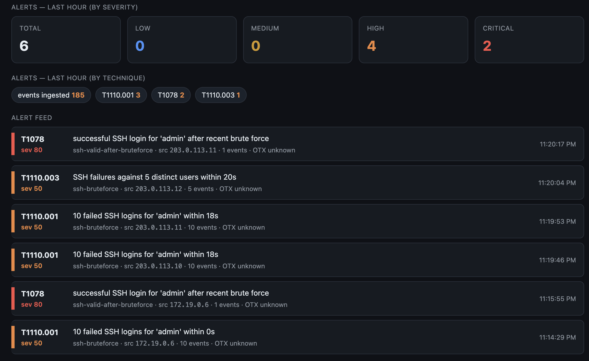

# SIEM Log Aggregator

A local, **$0** SIEM pipeline that runs entirely in Docker Compose: a small attack
lab produces real SSH and web logs → Kafka → normalized to one ECS schema and
tagged with AlienVault **OTX** threat intel → two **MITRE ATT&CK** detections
(T1110 Brute Force, T1078 Valid Accounts) → stored briefly in Postgres → served by
a FastAPI with a live dashboard.

No cloud services, no paid APIs, no honeypots. Everything is on your machine.



*Live dashboard (`http://localhost:8000/`): alert-severity tiles (High = T1110,
Critical = T1078), alerts by technique, and a streaming feed — here, four high and
two critical in the last hour, including a T1078 valid-accounts hit right after a
T1110.001 brute force and a T1110.003 spray.*

> **⚠ Safety / scope.** This is a self-contained lab. The `attacker` container runs
> `hydra` against a target SSH box, and the lab bundles a **deliberately vulnerable**
> web app (DVWA). The lab network is **`internal: true` — no internet route** — so the
> attack tools can only ever reach the lab's own containers. Don't point any of it at
> a real host.

```
 Attack lab                                    Injector
 (target-ssh, nginx + DVWA,                    (test scenarios as
  traffic-gen, attacker)                        raw log lines)
        |                                             |
        v                                             v
 producer-ssh, producer-web  ----> [Kafka: syslog-raw, web-logs-raw] <---+
 (tail shared log volumes)                    |
                                              v
 intel-updater ---> otx_ipv4.json ---> normalizer x2
 (OTX IPv4 set, 6h, ephemeral)         (parse -> ECS, tag OTX status)
                                              |
                                              v
                      [Kafka: normalized-security-events  (key = source.ip)]
                                     |                       |
                                     v                       v
                              detector x2              storage-writer
                           (plugin rules)         (batch inserts, 24h retention)
                                     |                       |
                                     v                       v
                      [Kafka: security-alerts]  ---->  PostgreSQL: events, alerts
                                     |                       |
                                     +-----------+-----------+
                                                 v
                              FastAPI :8000  (REST + WS /live + dashboard)
```

Every hop goes through a Kafka topic, so any stage can be restarted or scaled on
its own. Normalized events and alerts are keyed by `source.ip`, so all events from
one IP reach the same detector replica and its time windows stay correct.

## Quick start

Prerequisites: Docker Desktop (or Docker Engine + Compose v2). ~1 GB disk, a few GB RAM.

```bash
cp .env.example .env          # defaults are fine for a local run
docker compose up -d --build  # starts the whole stack (~first build takes a few min)
```

Then open the dashboard:

```
http://localhost:8000/          # live alert feed + stats
http://localhost:8000/docs      # interactive API docs
```

Give it a minute; `traffic-gen` produces normal SSH logins and page views in the
background. To see an alert fire, run an attack (below) and watch the dashboard.

**DVWA setup — not needed for the core build.** DVWA serves only normal traffic
here, so there's nothing to configure and nothing is automated. The web-attack
features (post-core) would need DVWA's one-time browser setup (Create/Reset
Database, log in `admin` / `password`, set security to Low) — a manual step — and
you'd first have to publish `target-web`'s port to reach it, since the lab network
is internal-only by design.

Stop / reset:

```bash
docker compose down     # stop, keep data volumes
make reset              # docker compose down -v (wipes Kafka, Postgres, logs, OTX cache)
```

## Make targets

| Command | What it does | Docker |
| --- | --- | --- |
| `make test` | Unit tests: parsers + detection rule logic (pytest) | no |
| `make pipeline` | Inject each scenario's raw lines, poll Postgres for the expected alerts | yes |
| `make e2e` | Run the real attacker scenarios A1–A3 + C1–C2, check `GET /alerts` | yes (~8–10 min) |
| `make up` / `make down` / `make reset` | start / stop / wipe | yes |

`make test` needs `pydantic` + `pytest` on the host (`pip install -r tests/requirements.txt`).
`make pipeline` / `make e2e` need the stack up.

## Attacks

Run a scenario and watch it flow through to the dashboard. Two ways:

**Real attacker** (hydra / sshpass against the lab):

```bash
docker compose exec attacker attack bruteforce-fail      # A1 -> T1110.001
docker compose exec attacker attack bruteforce-success   # A2 -> T1110.001 + T1078
docker compose exec attacker attack password-spray       # A3 -> T1110.003
docker compose exec attacker attack normal-typo          # C1 -> no alert (control)
docker compose exec attacker attack slow-guess           # C2 -> no alert (control, 5 min)
```

**Injector** (instant synthetic lines; pick the source IP):

```bash
docker compose run --rm injector bruteforce-success --ip 203.0.113.11   # -> T1110.001 + T1078
```

| Scenario | What it does | Expected |
| --- | --- | --- |
| A1 `bruteforce-fail` | ~50 wrong passwords for `admin` | one T1110.001 |
| A2 `bruteforce-success` | A1, then the real password | T1110.001, then T1078 |
| A3 `password-spray` | one password against ≥ 5 usernames | one T1110.003 |
| C1 `normal-typo` | one wrong password then the right one | no alert |
| C2 `slow-guess` | one wrong guess every 30 s for 5 min | no alert (see blind spot) |

## Detections

Rules are plugins: each is a class with `applies()` / `evaluate()`, registered in
`detector/rules/__init__.py`. Adding a rule is one class + one line; the engine and
other rules never change. All time comes from the event's `@timestamp`, never the
wall clock.

| Rule | Technique | Fires when | Severity |
| --- | --- | --- | --- |
| `ssh-bruteforce` | T1110.001 Password Guessing | ≥ 10 SSH failures against the **same** `(source.ip, user.name)` within 60 s | 50 |
| `ssh-bruteforce` | T1110.003 Password Spraying | failures from one IP against ≥ 5 distinct usernames within 5 min | 50 |
| `ssh-valid-after-bruteforce` | T1078 Valid Accounts | SSH success from an IP whose `bruteforce_seen` flag was set in the last 10 min | 80 |

Cooldown is one alert per `(rule, technique, source.ip)` per 5 min, so a 50-guess
run yields one alert and the two T1110 techniques alert independently. Thresholds
come from env vars (`BF_FAIL_COUNT`, `BF_WINDOW_S`, `SPRAY_USERS`, `SPRAY_WINDOW_S`,
`VALID_LOOKBACK_S`, `COOLDOWN_S`).

## API

FastAPI on port 8000:

| Endpoint | Returns |
| --- | --- |
| `GET /alerts?since=&limit=50` | newest alerts first |
| `GET /events?ip=&since=&limit=100` | events for one IP, newest first |
| `GET /stats` | last-hour event counts by severity band + alerts by technique |
| `WS /live` | each new alert as JSON as it arrives (Kafka group `api`) |
| `GET /health` | 200 once Postgres and Kafka are reachable |
| `GET /` | the live dashboard |

## OTX threat intel

`intel-updater` pulls AlienVault OTX IPv4 indicators in bulk (subscribed pulses,
last 30 days, IPv4 only, capped at 100k, newest first) into `otx_ipv4.json`, and
refreshes every 6 h. The normalizer loads that file in memory and tags each event
`known_bad` (+20 severity) or `unknown` — there is **no per-event OTX call**.

- Get a free key at [otx.alienvault.com](https://otx.alienvault.com) → Settings →
  API Integration, and put it in .env:
  `OTX_API_KEY=...`. With no key, everything is tagged `unknown` and the pipeline
  still runs.
- The IP list is **ephemeral**: it lives only in a Docker volume (not a host
  folder), is deleted when `intel-updater` stops, re-pulled on startup, and wiped
  by `make reset`.

## Scaling: 2 detectors sharing partitions

`normalized-security-events` has 3 partitions and the detector runs 2 replicas, so
the consumer group splits the partitions across them (keyed by `source.ip`, so each
IP's events always land on the same replica):

```
$ docker compose exec kafka /opt/kafka/bin/kafka-consumer-groups.sh \
    --bootstrap-server localhost:9092 --describe --group detectors

GROUP      TOPIC                       PARTITION  CURRENT-OFFSET  LOG-END-OFFSET  LAG  CONSUMER-ID              HOST
detectors  normalized-security-events  0          32              32              0    rdkafka-0ccc...e-449c    /172.19.0.9
detectors  normalized-security-events  1          647             647             0    rdkafka-0ccc...e-449c    /172.19.0.9
detectors  normalized-security-events  2          1246            1246            0    rdkafka-2ad4...f-8b16    /172.19.0.10
```

Two distinct consumers (`172.19.0.9` owns partitions 0 & 1, `172.19.0.10` owns
partition 2), lag 0 — both caught up.

## C2 blind spot (on purpose)

`C2 slow-guess` tries one wrong password every 30 s for 5 minutes. Because
T1110.001 needs ≥ 10 failures within a **60 s** window, a guess rate that stays
under that window never trips the rule — so C2 produces **no alert**. This is a
documented, tested trade-off: tight windows keep false positives low on bursty
brute force, at the cost of missing very slow, patient guessing. Detecting it would
need a much longer, lower-threshold window (more false positives) or cross-session
correlation, which is not in scope for the core build.

## Retention

The whole project stays well under 1 GB. Kafka: 2 h / 100 MB per partition with
16 MB segments. Postgres `events`: deleted after 24 h (every 10 min); `alerts` are
kept (one row per attack, not per line). `make reset` wipes everything.

## Repo layout

```
common/        schema.py (Event, Alert), kafka.py, config.py
lab/           target-ssh init, nginx.conf, traffic-gen/, attacker/ (+ wordlists)
producers/     tail.py (ssh/web -> raw topics)
normalizer/    main.py, parsers/{ssh,nginx}.py, enrich.py (OTX tagging)
intel/         updater.py (OTX bulk pull, ephemeral cache)
detector/      engine.py, state.py, rules/ (plugin rules)
storage/       writer.py, schema.sql
api/           main.py (FastAPI), dashboard.html
injector/      inject.py (scenario raw lines -> syslog-raw)
tests/         unit/, pipeline/, e2e/
docker-compose.yml, Makefile, .env.example
```

## Dashboard

The live dashboard is served at `http://localhost:8000/` (screenshot at the top):
alert-severity tiles (High = T1110, Critical = T1078), alerts by technique, and a
live feed streaming each new alert over `WS /live`.


